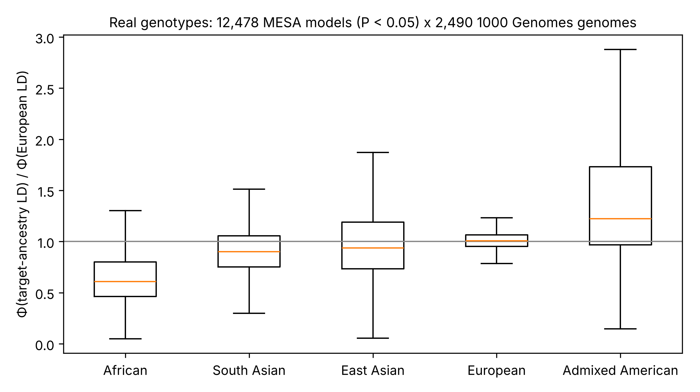

# twas-xcal

[](https://github.com/mqar96/twas-xcal/actions/workflows/tests.yml)
[](LICENSE)
[](pyproject.toml)
[](https://doi.org/10.5281/zenodo.24028643)

**Ancestry-aware null calibration for transcriptome-wide association studies (TWAS).**

`twas-xcal` implements **XCAL** and **XCAL-t**, gene-level TWAS statistics that stay calibrated under polygenic traits in *any* GWAS ancestry. It also ships a reproducible multi-ancestry TWAS null simulator. All results can be reproduced from public data (1000 Genomes phase 3, MESA DivPop expression models).

<p align="center">
  
  <br><em>The TWAS polygenic inflation slope Φ, relative to European LD, across 12,453 MESA expression models and five 1000 Genomes ancestries.</em>
</p>

---

## Contents
- [Why this matters](#why-this-matters)
- [Method](#method)
- [Installation](#installation)
- [Quick start](#quick-start)
- [Key results](#key-results)
- [Reproducing the paper](#reproducing-the-paper)
- [Repository layout](#repository-layout)
- [Citation](#citation)
- [Author](#author)

## Why this matters
TWAS tests (PrediXcan, S-PrediXcan, FUSION) are inflated under the null when the trait is polygenic. A gene-specific *variance-control* correction was recently proposed (Liang, Nyasimi & Im, *AJHG* 2026). Its inflation slope Φ depends on the LD structure of the GWAS population, and it has been validated only in European samples.

**`twas-xcal` shows that Φ is ancestry-specific.** It also provides a correction that transfers across ancestries:

| Setting | European-Φ variance control | **XCAL-t** |
|---|---|---|
| East Asian GWAS (simulation, genome-wide α) | up to **54×** excess false positives | 0.83–0.94× nominal |
| African GWAS (simulation) | over-corrected (0.40–0.54×) → lost power | calibrated, **~1.9× more power** |
| Real genomes (12,453 MESA models × 1000G, N·h² = 250k) | 4.5× (SAS) – 402× (AMR) | 0.63–0.85× nominal |

## Method
```
Z_XCAL = v'z / sqrt( v'R_t v + c · Q_t(v) ),     v = w ∘ s_t
```
| Symbol | Meaning |
|---|---|
| `w` | expression-model weights (e.g. PredictDB / MESA) |
| `z` | GWAS z-scores |
| `R_t`, `s_t` | LD matrix and SNP SDs from a reference panel **matched to the GWAS ancestry** |
| `Q_t(v)` | finite-sample-unbiased estimate of `v'Σ²v`: `[‖Rv‖² − (p/n)·v'Rv] / (1 + 1/n)` |
| `c = N·h²/M` | polygenic scale, estimated from the GWAS by LD-score regression |

**XCAL-t** adds a delete-block jackknife (K = 20) of the null variance with a Satterthwaite *t* reference, so it stays calibrated with small LD panels (~500 individuals, the size of a 1000 Genomes super-population). The full derivation is in [`docs/METHODS.md`](docs/METHODS.md).

## Installation
```bash
git clone https://github.com/mqar96/twas-xcal.git
cd twas-xcal
pip install -e .            # core: numpy, scipy, pandas
pip install -e ".[sim]"     # + simulator (msprime, stdpopsim, scikit-learn, matplotlib)
pip install -e ".[test]"    # + pytest
```
Requires Python ≥ 3.10.

## Quick start
```python
from xcal.core import run_xcal, estimate_c

# 1) Polygenic scale c from GWAS z-scores and ancestry-matched LD scores
c = estimate_c(gwas_z, ld_scores)["c"]

# 2) Gene-level XCAL statistics
#    weights_df : gene, snp, weight
#    gwas_df    : snp, z
#    panel_G    : (n_individuals × n_snps) genotype matrix of the GWAS ancestry
res = run_xcal(weights_df, gwas_df, panel_G, panel_snps, panel_pos, c=c, window_bp=1_000_000)
res.head()   # gene, z_standard, inflation_factor, z_xcal, p_xcal
```
XCAL-t (jackknife + t reference) is in `xcal.calibration` (`jackknife_panels`, `LQ_from_panels`, `satterthwaite_df`, `type1_t`).

## Key results
### Simulation (phase 1)
3,538 gene models, 500 regions, 74,298 settings. Type-I error divided by nominal at α = 1e-4:

| GWAS ancestry | Standard TWAS | Variance control (EUR Φ, EUR LD) | **XCAL-t** |
|---|---|---|---|
| European | 114–2,388× | 1.2–1.5× | 0.92–0.93× |
| East Asian | 118–2,348× | 3.7–8.6× | 0.89–0.90× |
| African | 45–1,361× | 1.9–2.3× | 0.92–0.94× |

These were validated against individual-level GWAS (N = 10,000 per ancestry, 80,000 tests per cell). The ratio of empirical to predicted variance is 0.994.

### Real genomes (phase 2)
12,453 MESA expression models × 2,490 1000 Genomes genomes. Median Φ relative to European LD (5–95%):

| Ancestry | Φ ratio |
|---|---|
| African | 0.60 (0.29–1.35) |
| South Asian | 0.89 (0.53–1.42) |
| East Asian | 0.90 (0.42–1.82) |
| Admixed American | 1.24 (0.69–3.66) |
| European | 1.03 |

Tables and figures are in [`results/`](results) and [`results/real/`](results/real).

## Reproducing the paper
```bash
bash scripts/run_all.sh work          # all simulations (~1.5 h on 2 CPU cores)
python -m pytest tests                # unit tests
```
Real-data steps (1000 Genomes download with MD5 checks, MESA model parsing, per-chromosome calibration) are documented in [`realdata/README.md`](realdata/README.md).

## Repository layout
```
xcal/          core library (XCAL, XCAL-t, simulator utilities)
scripts/       01–07: simulation pipeline for phase 1
realdata/      phase-2 pipeline on 1000 Genomes × MESA
results/       simulation tables and figures; results/real/ holds the real-data outputs
docs/          METHODS.md (theory and derivations)
tests/         unit tests
```

## Citation
If you use `twas-xcal`, please cite the software (see [`CITATION.cff`](CITATION.cff); GitHub's "Cite this repository" button gives BibTeX and APA):

> Rao, M. Q. A. (2026). *twas-xcal: ancestry-aware null calibration for transcriptome-wide association studies* (v0.1.0). Zenodo. https://doi.org/10.5281/zenodo.24028644

All versions: concept DOI [10.5281/zenodo.24028643](https://doi.org/10.5281/zenodo.24028643).

A manuscript describing the method is in preparation.

## Author
**Muhammad Qudduse Ahmad Rao**, Independent Researcher, Lahore, Pakistan
ORCID [0009-0001-8731-7080](https://orcid.org/0009-0001-8731-7080) · qudduse1234@gmail.com · GitHub [@mqar96](https://github.com/mqar96)

Contributions and issue reports are welcome. See [`CONTRIBUTING.md`](CONTRIBUTING.md).

## License
[MIT](LICENSE)
